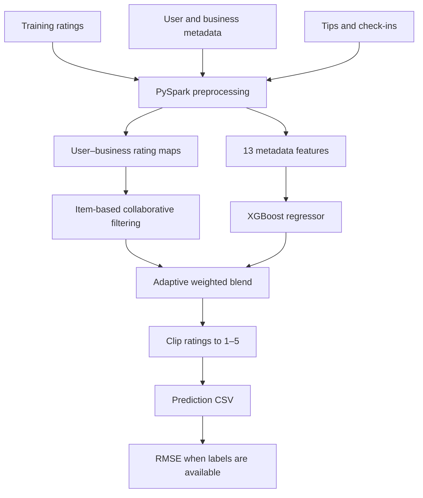

# Yelp Hybrid Recommender

### Discover the rating behind the review.

A hybrid recommendation pipeline that predicts a user's 1–5 star rating for a Yelp business. It combines **item-based collaborative filtering** with **XGBoost regression**, using PySpark to prepare ratings and metadata.

Built for the USC DSCI 553 competition project.

## Architecture at a glance



## Project structure

```text
yelp-hybrid-recommender/
├── competition.py          # Preprocessing, training, prediction, and evaluation
├── README.md               # Project guide
├── requirements.txt        # Python dependencies
├── .gitignore              # Local environments and generated outputs
└── dataset/
    ├── yelp_train.csv      # Training user–business ratings
    ├── yelp_val.csv        # Validation pairs and ratings
    ├── checkin.json        # Business check-in activity
    ├── photo.json          # Available auxiliary data; unused by this model
    └── similarity.csv      # Available auxiliary data; unused by this model
```

The implementation lives in one script. `Tool` contains parsing, Pearson similarity, and output helpers; `Solution.start()` orchestrates feature extraction, training, blending, and evaluation. File paths are passed through the command line.

## How the model works

### 1. Learn from similar businesses

The collaborative filtering branch computes Pearson correlations between businesses using their shared reviewers. It requires at least two shared users, keeps positive correlations, and selects up to **40 neighbors** from businesses the target user has rated.

The estimate starts with the target business's average rating and adds a weighted adjustment from neighbor rating deviations. The numerator uses squared positive similarity; the denominator sums positive similarity. When neighbors are unavailable, the code falls back to user/business averages, or the global average for a completely unseen pair.

### 2. Learn from metadata

XGBoost receives these **13 features**, in implementation order:

| # | Feature | Source |
| --- | --- | --- |
| 1 | Business average stars | `business.json` |
| 2 | User average stars | `user.json` |
| 3 | Business latitude | `business.json` |
| 4 | User review count | `user.json` |
| 5 | Business price range | `business.json` |
| 6 | Tip count per business | `tip.json` |
| 7 | Sum of six selected compliment counts | `user.json` |
| 8 | User useful votes | `user.json` |
| 9 | Business longitude | `business.json` |
| 10 | Business category count | `business.json` |
| 11 | Total business check-ins | `checkin.json` |
| 12 | Business review count | `business.json` |
| 13 | Tip count per user | `tip.json` |

The regressor uses 700 trees, depth 6, a 0.05 learning rate, 0.8 row/column sampling, and seed 553. Training occurs locally after Spark collects the prepared data.

### 3. Blend according to available evidence

```text
prediction = α × collaborative_prediction + (1 − α) × xgboost_prediction
```

| Positively correlated businesses rated by the user | CF weight α | XGBoost weight |
| --- | --- | --- |
| 15 or more | 0.30 | 0.70 |
| 5–14 | 0.15 | 0.85 |
| Fewer than 5 | 0.05 | 0.95 |

The final prediction is clipped to the valid **[1, 5]** range.

## Run locally

Use Python and a Java runtime compatible with the PySpark version you install. Dependencies are unpinned because the original runtime versions were not recorded.

```bash
cd yelp-hybrid-recommender
python -m venv .venv
source .venv/bin/activate
pip install -r requirements.txt
```

**Dataset prerequisite:** the current `dataset/` is incomplete for this script. Add `business.json`, `user.json`, and `tip.json` from the matching project dataset before running. The script reads all three unconditionally; `photo.json` and `similarity.csv` do not replace them.

Ratings CSV files must start with a header and use `user_id,business_id,stars` for training or labeled validation. Unlabeled prediction input can use `user_id,business_id`. Metadata files contain one JSON object per line.

Once the required files are present:

```bash
mkdir -p outputs
python competition.py dataset dataset/yelp_val.csv outputs/predictions.csv
```

General interface:

```text
python competition.py <dataset_folder> <test_csv> <output_csv>
```

Each run trains a fresh model and writes `user_id`, `business_id`, and `prediction` columns. If the test CSV includes ratings, the script also prints RMSE and absolute-error buckets. Spark uses `local[*]`, allowing it to use all available local cores.

## Recorded performance

The original script header records **RMSE 0.977267** and **299.9 seconds** execution time. These are historical figures, not a benchmark reproduced in this organized project; the exact hardware, dependency versions, and evaluation split were not recorded in the script.

## Practical boundaries

- Spark handles ingestion and aggregation, but rating maps and feature matrices are collected into driver memory. Memory requirements grow with dataset size.
- Pearson similarities are recomputed during prediction; large prediction sets can be expensive.
- The script does not save a trained model or tune parameters automatically.
- Missing metadata records receive feature defaults. Missing required input files still prevent execution.
- Dataset files remain local; check their source terms before redistributing them.
